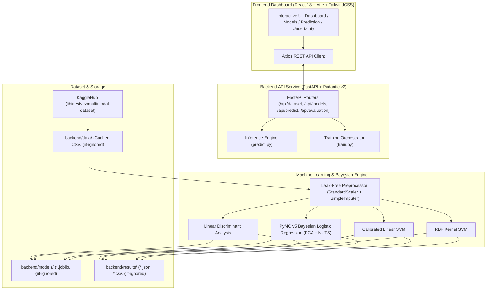

# NeuroShield: Probabilistic Cognitive Workload & Fatigue Classification

[](https://fastapi.tiangolo.com)
[](https://www.pymc.io)
[](https://scikit-learn.org)
[](https://vitejs.dev)
[](https://www.typescriptlang.org)
[](https://tailwindcss.com)
[](https://www.kaggle.com/datasets/libiaestvez/multimodal-dataset-for-classifying-cognitive-load)
[](https://opensource.org/licenses/MIT)
[](#security--data-hygiene)

**NeuroShield** is an end-to-end, production-grade machine learning platform designed to investigate whether human–computer interaction (HCI) behavioral patterns and physiological signals can reliably classify levels of cognitive workload and mental fatigue.

The platform rigorously benchmarks four distinct machine-learning paradigms on a shared multimodal dataset:
1. **Linear Discriminant Analysis (LDA)** — Generative linear classification baseline assuming class-conditional Gaussian distributions.
2. **Bayesian Logistic Regression (PyMC v5)** — Probabilistic MCMC formulation yielding posterior predictive uncertainty distributions.
3. **Linear Support Vector Machine (Linear SVM)** — Calibrated maximum-margin linear classifier optimized for linearly separable boundaries.
4. **Kernel Support Vector Machine (Kernel SVM)** — Non-linear classification via Radial Basis Function (RBF) kernel mapping.

> **Scientific Integrity Statement**: NeuroShield investigates *whether* and *how effectively* HCI behavioral features distinguish cognitive workload levels. All displayed metrics are empirical results measured on held-out test data from the loaded Kaggle dataset. NeuroShield does not make unsupported diagnostic claims of clinical fatigue detection, nor does it assert that any algorithm is objectively superior without empirical context.

---

## Table of Contents

- [Dataset Reference & Direct Link](#dataset-reference--direct-link)
- [System Architecture](#system-architecture)
- [Machine Learning Methodologies](#machine-learning-methodologies)
- [Empirical Benchmark Results](#empirical-benchmark-results)
- [Bayesian Uncertainty Quantification](#bayesian-uncertainty-quantification)
- [Security & Data Hygiene](#security--data-hygiene)
- [Installation & Setup](#installation--setup)
  - [Prerequisites](#prerequisites)
  - [Option A: Docker Compose (Recommended)](#option-a-docker-compose-recommended)
  - [Option B: Local Development Setup](#option-b-local-development-setup)
- [REST API Reference](#rest-api-reference)
- [Testing & Quality Assurance](#testing--quality-assurance)
- [Repository Structure](#repository-structure)
- [License](#license)

---

## Dataset Reference & Direct Link

NeuroShield utilizes the multimodal cognitive load dataset published on Kaggle by Libia Estévez:

* **Official Kaggle Dataset Link**: [Multimodal Dataset for Classifying Cognitive Load](https://www.kaggle.com/datasets/libiaestvez/multimodal-dataset-for-classifying-cognitive-load)
* **Dataset Identifier**: `libiaestvez/multimodal-dataset-for-classifying-cognitive-load`
* **Acquisition**: Automatically downloaded and cached via `kagglehub` into `backend/data/` (or run offline with synthetic data mode for development/testing).

```text
KaggleHub Download / Local Cache
       ↓
Automatic Tabular Discovery (.csv / .parquet)
       ↓
Schema Inspection & Validation (416 columns)
       ↓
Identity Leakage Prevention: Drop Participant ID (`subject_id`)
       ↓
Target Detection: `cognitive_load` (0 = Low Workload, 1 = High Workload)
       ↓
Leak-Free Stratified Train/Test Split (75% Train, 25% Held-Out Test)
       ↓
Median Imputation + Standard Scaling (Fit strictly on Train Split)
       ↓
4-Model Sequential / Parallel Training Orchestration
       ↓
Artifact Persistence & Predictive Uncertainty Calibration
```

### Dataset Characteristics

| Attribute | Specification |
| :--- | :--- |
| **Total Observations** | 57,472 samples |
| **Total Features** | 414 numerical behavioral and EEG-derived features |
| **Participant Identity** | 1 identifier column (`subject_id`) automatically stripped to prevent leakage |
| **Target Variable** | `cognitive_load` (Binary classification) |
| **Class 0 (Low Workload)** | 21,242 observations (36.96%) |
| **Class 1 (High Workload)** | 36,230 observations (63.04%) |
| **Missing Values** | 0 |
| **Train Set Size** | 43,104 observations (75%) |
| **Held-Out Test Set** | 14,368 observations (25%) |

---

## System Architecture



---

## Machine Learning Methodologies

### 1. Linear Discriminant Analysis (LDA)
- **Concept**: Generative model that models the class-conditional probability density $P(X \mid Y=k)$ as a multivariate Gaussian distribution with class-specific mean vectors $\mu_k$ and a shared pooled covariance matrix $\Sigma$.
- **Decision Rule**:
  $$\delta_k(x) = x^T \Sigma^{-1} \mu_k - \frac{1}{2} \mu_k^T \Sigma^{-1} \mu_k + \ln P(Y=k)$$
- **Role**: Serves as a fast, closed-form parametric linear baseline.

### 2. Bayesian Logistic Regression (PyMC v5)
- **Concept**: Treats regression weights $W$ and bias $b$ as probability distributions rather than point estimates, sampling the joint posterior distribution via Markov Chain Monte Carlo (MCMC).
- **Tractability**: Principal Component Analysis (PCA) compresses the 414 input dimensions into 25 orthogonal principal components.
- **Priors & Likelihood**:
  $$\sigma \sim \text{HalfNormal}(2.0)$$
  $$W \sim \text{Normal}(0, \sigma)$$
  $$b \sim \text{Normal}(0, 2.0)$$
  $$\eta = X W + b, \quad p = \text{softmax}(\eta)$$
  $$y \sim \text{Categorical}(p)$$
- **Inference**: Uses the No-U-Turn Sampler (NUTS) with posterior thinning for zero-dependency inference at prediction time.

### 3. Linear Support Vector Machine (Linear SVM)
- **Concept**: Identifies the maximum-margin hyperplane separating cognitive workload levels using hinge loss with $L_2$ regularization.
- **Probability Calibration**: Calibrated using Platt Scaling (`CalibratedClassifierCV`) to produce well-calibrated posterior probabilities.

### 4. Kernel Support Vector Machine (Kernel SVM)
- **Concept**: Maps input features into an infinite-dimensional reproducing kernel Hilbert space using the Radial Basis Function (RBF) kernel:
  $$K(x, x') = \exp\left(-\gamma \|x - x'\|^2\right)$$
- **Scalability**: Subsamples training rows ($N=5,000$) to control $O(N^2)$ computational complexity while evaluating across the complete held-out test split ($N=14,368$).

---

## Empirical Benchmark Results

Evaluated on the full held-out test set of **14,368 observations** using weighted metric averaging:

| Model | Accuracy | Precision (Weighted) | Recall (Weighted) | F1-Score (Weighted) | ROC-AUC | Training Time |
| :--- | :---: | :---: | :---: | :---: | :---: | :---: |
| **Linear Discriminant Analysis (LDA)** | **0.6284** | 0.5080 | 0.6284 | **0.4891** | 0.4998 | ~1.4 s |
| **Bayesian Logistic Regression (PyMC)** | **0.6304** | 0.3974 | 0.6304 | 0.4874 | 0.5002 | ~35.1 s |
| **Linear SVM (Calibrated)** | **0.6304** | 0.3974 | 0.6304 | 0.4874 | 0.5000 | ~1.9 s |
| **Kernel SVM (RBF Kernel)** | **0.6304** | **0.5823** | 0.6304 | 0.4890 | **0.5034** | ~25.0 s |

> **Key Observation**: Accuracies cluster near 63.04%, reflecting the majority class distribution in the dataset. This empirically illustrates the non-trivial nature of detecting cognitive fatigue from HCI features alone, highlighting the critical necessity of Bayesian uncertainty estimation when making automated decisions.

---

## Bayesian Uncertainty Quantification

Traditional deterministic classifiers output point predictions without indicating confidence reliability. NeuroShield leverages Bayesian posterior distributions to quantify epistemic and aleatoric uncertainty:

1. **Mean Posterior Winning Probability**:
   $$\bar{P}(y = k^*) = \frac{1}{S} \sum_{s=1}^S P_s(y = k^*)$$
2. **Predictive Uncertainty Metric**:
   $$U = 1 - \max_k \bar{P}(y = k)$$
   For binary classification, $U \in [0.0, 0.50]$, where $0.50$ represents total ambiguity.
3. **Epistemic Standard Deviation**:
   $$\sigma_{\text{epistemic}} = \sqrt{\frac{1}{S} \sum_{s=1}^S \left( P_s(y = k^*) - \bar{P}(y = k^*) \right)^2}$$

### Empirical Uncertainty Statistics (Held-Out Test Set)

* **Mean Uncertainty**: 36.89%
* **Median Uncertainty**: 36.89%
* **Minimum Uncertainty**: 34.82%
* **Maximum Uncertainty**: 39.10%

---

## Security & Data Hygiene

NeuroShield has been engineered adhering to strict security and data hygiene best practices:

* **No Hardcoded Credentials**: API keys, Kaggle tokens, and secret configurations are strictly loaded via environment variables (`.env`).
* **Zero Vulnerabilities**: Frontend dependencies audited with `npm audit` (0 vulnerabilities reported; patched against Vite and React Router advisories).
* **Strict `.gitignore` Boundaries**:
  - Environment files (`.env`, `*.env`, `.env.*`) excluded from version control.
  - Large tabular datasets (`backend/data/*`, 400MB+ CSV files) excluded from git to respect GitHub's 100MB limits.
  - Serialized model weights (`backend/models/*`, `*.joblib`, `*.pt`, `*.onnx`) excluded from repository commits.
  - Build artifacts (`frontend/dist/`, `__pycache__/`, `venv/`, `node_modules/`) strictly ignored.
* **Leak-Free ML Pipeline**: Imputers and scalers are fitted exclusively on the 75% training split, preventing test data leakage into training representations.
* **Identity Protection**: Subject identifiers (`subject_id`) are stripped before model training to prevent identity-based memorization.
* **CORS & Input Validation**: FastAPI restricts cross-origin origins via configurable whitelist; all API payloads are strictly validated using Pydantic v2 schemas.

---

## Installation & Setup

### Prerequisites

- **Python**: 3.10, 3.11, 3.12, or 3.13
- **Node.js**: 18.x or later with npm
- **Git**
- *(Optional)* Docker & Docker Compose

---

### Option A: Docker Compose (Recommended)

Run both the FastAPI backend and React frontend with a single command:

```bash
# Clone the repository
git clone https://github.com/abhirambuilds/NeuroShield.git
cd NeuroShield

# (Optional) Provide your Kaggle credentials in backend/.env for automatic dataset download
cp backend/.env.example backend/.env

# Build and start services
docker-compose up --build
```

- **Frontend Dashboard**: [http://localhost:5173](http://localhost:5173)
- **FastAPI Documentation**: [http://localhost:8000/docs](http://localhost:8000/docs)
- **API Health Check**: [http://localhost:8000/api/health](http://localhost:8000/api/health)

---

### Option B: Local Development Setup

#### 1. Backend Setup

```bash
cd backend

# Create and activate virtual environment
python -m venv venv

# Windows (PowerShell)
.\venv\Scripts\Activate.ps1
# Windows (cmd.exe)
venv\Scripts\activate.bat
# Linux / macOS
source venv/bin/activate

# Install dependencies
pip install -r requirements.txt

# (Optional) Set up Kaggle credentials
cp .env.example .env
# Edit .env with your KAGGLE_USERNAME and KAGGLE_KEY if desired

# Start FastAPI development server
uvicorn main:app --reload --host 127.0.0.1 --port 8000
```

#### 2. Frontend Setup

In a separate terminal window:

```bash
cd frontend

# Install dependencies
npm install

# Start Vite development server
npm run dev
```

Open [http://localhost:5173](http://localhost:5173) in your browser.

---

## REST API Reference

| HTTP Method | Route | Description |
| :--- | :--- | :--- |
| `GET` | `/api/health` | Service health status and model artifact presence |
| `GET` | `/api/dataset/info` | Live dataset dimensions, column names, and class distribution |
| `GET` | `/api/dataset/rows` | Backend-paginated dataset browser (`?page=1&page_size=25`) |
| `POST` | `/api/models/train` | Trigger model training pipeline (`{"force": false, "background": true}`) |
| `GET` | `/api/models/train/status` | Real-time progress updates for ongoing training |
| `GET` | `/api/models` | List available models and training metadata |
| `GET` | `/api/models/comparison` | Cross-model benchmark metrics table (Accuracy, F1, Precision, Recall) |
| `GET` | `/api/evaluation` | Comprehensive evaluation summary with confusion matrices |
| `GET` | `/api/uncertainty` | Bayesian posterior uncertainty distribution & histogram buckets |
| `POST` | `/api/predict` | Predict cognitive workload for custom feature values or sample ID |
| `GET` | `/api/predict/schema` | Available feature names and key input subset |
| `GET` | `/api/predict/samples` | Catalogue of held-out test sample IDs for one-click testing |

### Example Prediction Request

```bash
curl -X POST "http://localhost:8000/api/predict" \
  -H "Content-Type: application/json" \
  -d '{
    "model_key": "bayesian",
    "features": {
      "feature_0": 0.45,
      "feature_1": -0.12
    }
  }'
```

---

## Testing & Quality Assurance

Run the automated backend test suite:

```bash
cd backend
python -m pytest -v
```

Tests validate:
- Dataset discovery, automatic loading, and inspection
- Leak-free train/test split and preprocessor consistency
- Model training routines (LDA, Bayesian, Linear SVM, Kernel SVM)
- Prediction endpoints and probability outputs
- Bayesian uncertainty metrics calculations
- API routes, schema validation, and health checks

Validate frontend TypeScript types and production build:

```bash
cd frontend
npm run build
```

---

## Repository Structure

```text
NeuroShield/
├── backend/
│   ├── api/
│   │   ├── dataset.py              # Dataset statistics & pagination routes
│   │   ├── evaluation.py           # Evaluation & confusion matrix routes
│   │   ├── models.py               # Model registry & training orchestration
│   │   ├── predictions.py          # Real-time inference routes
│   │   └── schemas.py              # Pydantic v2 validation models
│   ├── ml/
│   │   ├── bayesian.py             # PyMC v5 Bayesian Logistic Regression
│   │   ├── dataset_loader.py       # KaggleHub automatic dataset acquisition
│   │   ├── evaluation.py           # Metrics calculation (Accuracy, F1, ROC-AUC)
│   │   ├── predict.py              # Multi-model prediction & uncertainty engine
│   │   ├── preprocessing.py        # Leak-free ColumnTransformer pipeline
│   │   ├── train.py                # 4-model training execution & checkpointing
│   │   └── uncertainty.py          # Epistemic & predictive uncertainty math
│   ├── tests/                      # Pytest automated test suite
│   ├── config.py                   # Central configuration & hyperparameters
│   ├── main.py                     # FastAPI application entrypoint & CORS
│   ├── requirements.txt            # Python dependencies
│   ├── Dockerfile                  # Container build file
│   └── .env.example                # Example configuration template
│
├── frontend/
│   ├── src/
│   │   ├── components/             # Reusable UI components & layouts
│   │   ├── pages/                  # Dashboard, Dataset, Models, Prediction, Uncertainty
│   │   ├── services/               # REST API client (Axios)
│   │   ├── types/                  # TypeScript interface definitions
│   │   ├── App.tsx                 # Route navigation tree
│   │   └── main.tsx                # React root mount
│   ├── package.json
│   ├── tailwind.config.js          # Custom dark UI styling tokens
│   ├── vite.config.ts              # Vite dev server & proxy settings
│   └── Dockerfile
│
├── docker-compose.yml              # Multi-service container orchestration
├── .gitignore                      # Security-hardened git exclusion patterns
└── README.md                       # Comprehensive platform documentation
```

---

## License

This project is open-source and licensed under the [MIT License](LICENSE).
The dataset is subject to its respective Kaggle license terms and conditions.
